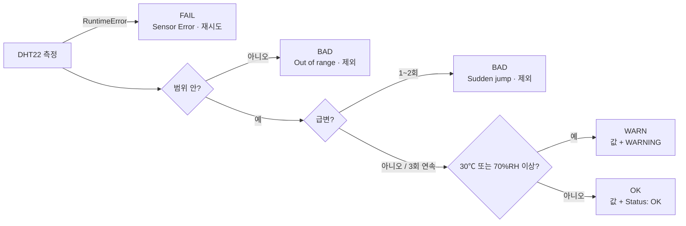

## 1. 이번 주에 배운 것

| 주차 | 번호 | 목표 | 쉽게 말하면 |
|:---:|:---:|---|---|
| 5주차 | 1 | 센서와 아날로그·디지털 신호의 차이 | 센서가 숫자를 어떤 방식으로 보내는지 |
| 5주차 | 2 | 온·습도 센서를 안전하게 연결하고 읽기 | VCC·DATA·GND를 맞게 꽂고 값 읽기 |
| 5주차 | 3 | 측정 실패와 비정상 값을 구분해 예외 처리 | 숫자가 나와도 바로 믿지 않기 |
| 6주차 | 4 | GPIO 직접 연결과 I²C 통신의 차이 | 선 두 개로 여러 장치를 연결하는 법 |
| 6주차 | 5 | SDA·SCL·주소로 I²C 장치 탐색 | 버스에 붙은 장치를 주소로 찾기 |
| 6주차 | 6 | OLED에 검증된 센서값과 오류 표시 | 측정 결과를 작은 화면에 보여 주기 |

## 2. 준비물

| 부품 | 개수 | 비고 |
|---|:---:|---|
| Raspberry Pi 4 | 1 | Python 가상환경(`.venv`) 사용 |
| DHT22 온·습도 센서 모듈 | 1 | 핀: VCC · DATA · NC · GND |
| SSD1306 OLED (128×64, I²C) | 1 | 핀: GND · VCC · SCL · SDA |
| 점퍼선 (암-암) | 7 | 브레드보드 없이 직접 연결 |

---

## 3. 핵심 개념 정리

### 3-1. 센서와 신호

| 단계 | 하는 일 | 예시 |
|---|---|---|
| 물리량 | 실제 환경에서 연속적으로 변함 | 온도, 습도, 밝기 |
| 센서 | 물리 변화를 감지해 전기 신호·디지털 데이터로 변환 | DHT22 |
| 프로그램 | 값을 해석해서 표시·저장·제어 | Python, OLED 표시 |

| 구분 | 아날로그 센서 | 디지털 센서 |
|---|---|---|
| 출력 | 연속적인 전압 | 데이터 패킷(0과 1) |
| Raspberry Pi 연결 | ADC(MCP3008, ADS1115)를 거쳐야 함 | GPIO·통신 버스로 직접 수신 |
| 이번 실습 | — | **DHT22** (DATA → GPIO17) |

> Raspberry Pi에는 ADC가 없어서 아날로그 전압을 직접 숫자로 읽지 못한다.

### 3-2. 측정값 = 숫자 + 단위 + 맥락

| 항목 | 의미 | 표기 |
|---|---|---|
| 온도 | 공기가 뜨겁거나 차가운 정도 | ℃ |
| 상대습도 | 지금 수증기량 ÷ 같은 온도에서의 최대 수증기량 | %RH |
| 측정 맥락 | 값과 함께 남길 정보 | 시각, 센서 종류, 성공 여부 |

### 3-3. 측정 실패 vs 비정상 값 ★

| 구분 | 측정 실패 | 비정상 값 |
|---|---|---|
| 상황 | **값을 받지 못함** | **숫자는 받았지만 믿을 수 없음** |
| 원인 | 통신 오류, 시간 초과 | 범위 초과, 비현실적인 급변 |
| Python | `RuntimeError` | 검증 단계에서 걸러냄 |
| 처리 | 2초 기다렸다가 **재시도** | **저장에서 제외**, 원인 기록 |

| 검증 기준 | 값 | 근거 |
|---|---|---|
| 온도 범위 | −40 ~ 80 ℃ | DHT22 데이터시트 |
| 습도 범위 | 0 ~ 100 %RH | 상대습도 정의 |
| 최소 측정 간격 | 2초 | DHT22 데이터시트 |

### 3-4. 센서 프로그램 생명주기

| 단계 | 하는 일 | 코드 |
|---|---|---|
| 초기화 | 센서·OLED 객체 생성 | `adafruit_dht.DHT22(...)`, `SSD1306_I2C(...)` |
| 측정 | 온도·습도 읽기 | `sensor.temperature`, `sensor.humidity` |
| 검증 | None·범위·급변 검사 | `judge()` |
| 사용 | OLED 표시, CSV 저장 | `show()`, `writer.writerow()` |
| 오류 처리 | 실패 기록 후 재시도 | `try` / `except RuntimeError` |
| 정리 | 화면 지우고 자원 해제 | `finally: sensor.exit()` |

### 3-5. 통신 방식 비교

| 구분 | UART | **I²C** | SPI |
|---|---|---|---|
| 신호선 | TX, RX | **SDA, SCL (2개)** | MOSI, MISO, SCLK, CS |
| 특징 | 두 장치 간 비동기 | **주소로 여러 장치 구분** | 빠르지만 선이 많음 |
| 예 | GPS, 시리얼 콘솔 | 센서, RTC, **OLED** | 고속 ADC, LCD |

### 3-6. I²C 용어

| 용어 | 뜻 | 비유 |
|---|---|---|
| **SDA** | 주소·명령·데이터가 오가는 데이터선 | 대화 내용 |
| **SCL** | 비트를 읽을 시점을 알려 주는 클록선 | 박자 맞추는 메트로놈 |
| **Controller / Target** | 통신을 시작하는 쪽(Pi) / 응답하는 쪽(OLED) | 선생님 / 이름 불린 학생 |
| **I²C 주소** | 같은 버스의 장치를 구분하는 7비트 번호(예: `0x3C`) | 출석 번호 |
| **풀업 저항** | 아무도 LOW로 당기지 않을 때 선을 HIGH로 유지 | 평소 위치로 돌아가는 고무줄 |
| **프레임버퍼** | 화면에 보낼 픽셀을 미리 그려 두는 메모리 | 칠판에 쓰기 전 연습장 |

### 3-7. OLED 화면 갱신 순서

| 순서 | 코드 | 하는 일 |
|:---:|---|---|
| 1 | `display.fill(0)` | 버퍼를 검정으로 지움(안 하면 이전 글자가 남음) |
| 2 | `display.text("T: 25.4 C", 0, 0, 1)` | 버퍼에 글자 그리기. 원점은 **왼쪽 위**, 1 = 픽셀 켜기 |
| 3 | `display.show()` | 버퍼 내용을 I²C로 실제 화면에 전송 |

> `display.text()`는 글꼴 파일 `font5x8.bin`이 실행 폴더에 있어야 동작한다.

---

## 4. 원본 자료와 실제 실습의 차이

수업 자료의 5주차 측정 코드와 6주차 OLED 코드를 **한 파일(`week7/oled.py`)로 합쳐서** 진행했습니다.

| 항목 | 수업 자료 | 실제로 한 방법 | 바꾼 이유 |
|---|---|---|---|
| 오류 화면 | 측정 실패·비정상 값을 모두 `Sensor Error` 하나로 표시 | **FAIL(측정 실패)과 BAD(비정상 값) 화면을 분리** | 5주차 핵심인 "실패 vs 비정상"을 화면에서도 구분하려고 |
| 값 검증 | None + 범위 검사 | None + 범위 + **급변 검사**(2초에 2℃ / 5%RH 초과) | 범위 안이지만 순간적으로 튀는 값까지 거르려고 |
| 급변 처리 | — | 1~2회 급변은 제외, **3회 연속이면 실제 변화로 인정** | 입김 같은 진짜 변화까지 버리지 않으려고 |
| 경고(미션 C) | 별도 미션 | 같은 코드에 **WARN 상태**로 포함(30℃ 또는 70%RH 이상) | 정상 값 중 위험 구간을 따로 표시 |
| 기록 | 화면 출력만 | **`log.csv`에 매 측정 기록** + 화면 아랫줄에 OK/FAIL/BAD 횟수 | 신뢰성 증거를 남기려고 |
| OLED 핀 순서 | VCC · GND · SCL · SDA | 실제 모듈은 **GND · VCC · SCL · SDA** | 보드 인쇄 글자를 보고 연결 |
| OLED GND | 핀 6 | **핀 25** | GND는 내부에서 모두 연결되어 있어 동일. 선이 겹치지 않게 |
| 3.3V 전원 | — | DHT22는 **핀 1**, OLED는 **핀 17** | 3.3V 핀이 두 개라 하나씩 사용 |
| 라이브러리 설치 | `pip install`만 | `swig`, `liblgpio-dev`를 apt로 먼저 설치 | `lgpio` 빌드 실패 해결(8장 참고) |

---

## 5. 회로

### 5-1. 배선도


### 5-2. 사용한 핀

| 물리 핀 | 이름 | 연결 대상 | 선 색 | 역할 |
|:---:|---|---|---|---|
| 1 | 3.3V | DHT22 VCC | 빨강 | 센서 전원 |
| 11 | GPIO17 | DHT22 DATA | 노랑 | 온·습도 데이터 |
| 9 | GND | DHT22 GND | 검정 | 센서 접지 |
| — | — | DHT22 NC | — | 연결 안 함 |
| 17 | 3.3V | OLED VCC | 빨강 | OLED 전원 |
| 25 | GND | OLED GND | 검정 | OLED 접지 |
| 5 | GPIO3 (SCL) | OLED SCL | 초록 | I²C 클록 |
| 3 | GPIO2 (SDA) | OLED SDA | 파랑 | I²C 데이터 |

> 핀 1 찾기: USB·LAN 포트를 오른쪽에 두면, 40핀 헤더의 **보드 안쪽 줄 맨 왼쪽**이 핀 1. 안쪽 줄이 홀수(1, 3, 5…), 바깥쪽 줄이 짝수.
> DHT22 DATA(GPIO17)와 OLED SDA·SCL은 서로 다른 핀이라 공유하지 않는다.

### 5-3. 실제 연결 사진


---

## 6. 코드

### 6-1. 환경 준비

```bash
sudo raspi-config nonint do_i2c 0      # I2C 켜기 → 재부팅
sudo apt install -y i2c-tools libgpiod2 swig liblgpio-dev python3-dev
python3 -m venv .venv
source .venv/bin/activate              # 새 터미널마다 다시 실행
python -m pip install adafruit-blinka adafruit-circuitpython-dht adafruit-circuitpython-ssd1306
python -c "import board, adafruit_dht, adafruit_ssd1306; print('OK')"
```

### 6-2. 판정 흐름



| 판정 | 조건 | OLED 화면 |
|---|---|---|
| **OK** | 범위 안, 급변 없음 | `T: 25.4 C` / `H: 61.2 %RH` / `Status: OK` |
| **WARN** | 정상 값이지만 30℃ 또는 70%RH 이상 | 값 + `!! WARNING !!` |
| **FAIL** | 값을 받지 못함(`RuntimeError`) | `Sensor Error` / 오류 메시지 / `Retry in 2s` |
| **BAD** | 범위 초과 또는 1~2회 급변 | `Bad value-excluded` / 이유 / 원래 값 |

### 6-3. 통합 코드 (`week7/oled.py`)

```python
import csv
import time
from datetime import datetime

import board
import busio
import adafruit_dht
import adafruit_ssd1306

# ---------------- 설정 ----------------
OLED_ADDR = 0x3C          # i2cdetect -y 1 에서 확인한 주소
INTERVAL = 2.0            # DHT22 최소 측정 간격 2초
TEMP_RANGE = (-40, 80)    # DHT22 데이터시트 측정 범위(℃)
HUM_RANGE = (0, 100)      # 상대습도 범위(%RH)
MAX_DT = 2.0              # 2초 사이 허용 온도 변화(℃)
MAX_DH = 5.0              # 2초 사이 허용 습도 변화(%RH)
JUMP_ACCEPT = 3           # 급변이 3회 연속이면 실제 변화로 인정
WARN_T, WARN_H = 30, 70   # 미션 C 경고 기준
TEST_INJECT = 0           # 0=끔, 5=5회마다 150℃ 가짜 값 주입(비정상 경로 시험용)

# ---------------- 초기화 ----------------
sensor = adafruit_dht.DHT22(board.D17, use_pulseio=False)   # DATA = GPIO17(물리 핀 11)
i2c = busio.I2C(board.SCL, board.SDA)                       # SCL 핀 5, SDA 핀 3
display = adafruit_ssd1306.SSD1306_I2C(128, 64, i2c, addr=OLED_ADDR)

state = {"prev": None, "jumps": 0}   # 마지막 정상값, 연속 급변 횟수
count = {"OK": 0, "WARN": 0, "FAIL": 0, "BAD": 0}


def judge(t, h):
    """받은 숫자가 믿을 만한지 판정. (결과, 이유) 반환"""
    if t is None or h is None:
        return "BAD", "No value"
    if not (TEMP_RANGE[0] <= t <= TEMP_RANGE[1] and HUM_RANGE[0] <= h <= HUM_RANGE[1]):
        return "BAD", "Out of range"
    prev = state["prev"]
    if prev and (abs(t - prev[0]) > MAX_DT or abs(h - prev[1]) > MAX_DH):
        state["jumps"] += 1
        if state["jumps"] < JUMP_ACCEPT:
            return "BAD", "Sudden jump"
        # 3회 연속 급변이면 순간 오류가 아니라 실제 환경 변화로 보고 받아들임
    state["prev"] = (t, h)
    state["jumps"] = 0
    if t >= WARN_T or h >= WARN_H:
        return "WARN", "Too hot/humid"
    return "OK", ""


def show(lines):
    display.fill(0)                            # 이전 화면 지우기(잔상 방지)
    for i, line in enumerate(lines):
        display.text(line[:21], 0, i * 13, 1)  # 한 줄 최대 21자, 13px 간격
    display.show()


def counts_line():
    ok = count["OK"] + count["WARN"]
    return f"OK{ok} F{count['FAIL']} B{count['BAD']}"


log = open("log.csv", "a", newline="")
writer = csv.writer(log)
n = 0

try:
    show(["Embedded System", "DHT22 + OLED", "Starting..."])
    while True:
        n += 1
        now = datetime.now().strftime("%Y-%m-%d %H:%M:%S")
        try:
            t = sensor.temperature
            h = sensor.humidity
            if TEST_INJECT and n % TEST_INJECT == 0:
                t = 150.0                     # 일부러 넣은 비정상 값
            result, reason = judge(t, h)
        except RuntimeError as error:          # 통신 실패·시간 초과
            t = h = None
            result, reason = "FAIL", str(error)

        count[result] += 1

        if result in ("OK", "WARN"):
            show([
                f"T: {t:.1f} C",
                f"H: {h:.1f} %RH",
                "!! WARNING !!" if result == "WARN" else "Status: OK",
                counts_line(),
            ])
        elif result == "FAIL":
            show(["Sensor Error", reason, "Retry in 2s", counts_line()])
        else:  # BAD
            raw = f"T{t} H{h}" if t is not None else "raw: None"
            show(["Bad value-excluded", reason, raw, counts_line()])

        print(f"{n:03d} {now} | {result:4} | T={t} H={h} | {reason}")
        writer.writerow([now, result, t, h, reason])
        log.flush()
        time.sleep(INTERVAL)
except KeyboardInterrupt:
    print("\n종료 요약:", count)
finally:
    display.fill(0)
    display.show()
    sensor.exit()
    log.close()
```

| 코드 요소 | 의미 |
|---|---|
| `board.D17`, `use_pulseio=False` | DHT22 DATA = BCM GPIO17, 비트뱅 방식으로 읽기 |
| `busio.I2C(board.SCL, board.SDA)` | OLED용 I²C 버스(GPIO3·GPIO2) |
| `SSD1306_I2C(128, 64, i2c, addr=0x3C)` | 해상도·버스·`i2cdetect`로 찾은 주소 |
| `except RuntimeError` | 측정 실패(FAIL) → 화면 표시 후 2초 뒤 재시도 |
| `judge()` | 비정상 값(BAD)·경고(WARN)·정상(OK) 판정 |
| `log.flush()` | 매 측정마다 CSV에 바로 기록 |
| `finally` | Ctrl+C로 끝나도 화면 지우고 센서 자원 정리 |

---

## 7. 실행 결과


| 화면 줄 | 표시 | 해석 |
|---|---|---|
| 1 | `T: 27.3 C` | 온도 27.3 ℃ (경고 기준 30 ℃ 미만) |
| 2 | `H: 76.6 %RH` | 습도 76.6 %RH (경고 기준 70 %RH **이상**) |
| 3 | `!! WARNING !!` | 습도 조건으로 WARN 판정 → **미션 C 동작 확인** |
| 4 | `OK10 F1 B0` | 정상(OK+WARN) 10회, 측정 실패 1회, 비정상 값 0회 |

| 확인한 것 | 결과 |
|---|---|
| 온·습도 2초 갱신, 값과 단위 표시 (미션 B) | ✅ |
| 30℃ 또는 70%RH 이상 경고 (미션 C) | ✅ 습도 76.6 %RH에서 WARNING |
| 측정 실패 처리 | ✅ 실행 중 자연 발생한 측정 실패 1회(`F1`)를 프로그램이 멈추지 않고 넘기고 다음 측정에서 정상 복귀 |
| 비정상 값 | 이번 측정에서는 0회(`B0`) — 범위 밖 값이나 급변이 없었음 |

---

## 8. 문제 해결 기록

| 순서 | 증상 | 원인 | 해결 |
|:---:|---|---|---|
| 1 | `ModuleNotFoundError: No module named 'board'` | 가상환경이 꺼진 상태에서 시스템 Python으로 실행 | `source .venv/bin/activate` 후 실행 (프롬프트 앞에 `(.venv)` 확인) |
| 2 | `Failed building wheel for lgpio` / `command 'swig' failed` | `lgpio` 빌드에 필요한 `swig`가 없어서 설치 중단 → 나머지 패키지도 미설치 | `sudo apt install swig liblgpio-dev python3-dev` 후 다시 `pip install` → `OK` 출력 |
| 3 | `ValueError: No Hardware I2C on (scl,sda)=(3, 2)` / `Make sure I2C is enabled` | 운영체제에서 I²C가 꺼져 있음 | `sudo raspi-config nonint do_i2c 0` → 재부팅 → `/dev/i2c-1` 확인 |
| 4 | 재부팅 후 다시 `No module named 'board'` | 재부팅으로 가상환경도 꺼짐 | 가상환경 다시 활성화 |
| 5 | `i2cdetect -y 1` 표가 전부 `--` | OLED가 응답하지 않음(배선 문제) | 전원을 끄고 VCC·GND·SDA·SCL 배선 재점검 → OLED 정상 표시 |
| 6 | `git push` 했는데 `Everything up-to-date` | `git add`만 하고 `commit`을 안 함 | `.gitignore`에 `.venv/` 추가 → `commit` → `push` |

> 배운 점: 오류 메시지가 "회로 문제"처럼 보여도 먼저 **환경(가상환경) → 운영체제 설정(I²C) → 배선** 순서로 좁혀 가면 원인을 빨리 찾을 수 있다. `/dev/i2c-1`이 보이는 것은 버스가 준비됐다는 뜻일 뿐이고, OLED 인식은 `i2cdetect`로 따로 확인해야 한다.
